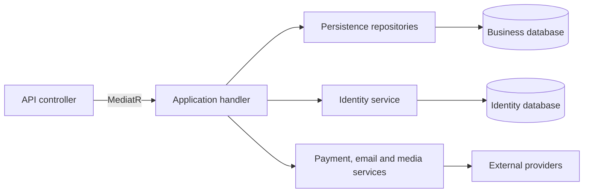

# Investry

ASP.NET Core API connecting project founders with investors. It supports equity, reward and Mudarabah funding, with user wallets, escrow transactions, campaign review and Didit identity verification.

Originally developed as a team graduation project. I worked across the backend modules and maintain this version, with improvements to authorization, investment validation, wallet processing, and regression tests.

The solution uses .NET 8, EF Core with SQL Server, ASP.NET Core Identity, JWT authentication, MediatR, FluentValidation and AutoMapper. The existing Clean Architecture structure separates Domain, Application, Identity, Infrastructure, Persistence and API projects. External integrations use Stripe, SendGrid, Cloudinary and Didit.

## How funding works

1. A founder with approved KYC submits a campaign with its funding model, target, dates and media. It starts as `PendingReview`.
2. An administrator approves the campaign, moving it to `Published`. It becomes visible in project search; investment is allowed only between its start and end dates.
3. An investor requests a wallet deposit and completes Stripe Checkout. The signed payment webhook must match the pending deposit before the wallet is credited.
4. The investor chooses a project and submits an investment. The handler checks the campaign, previous investments, contribution limits, funding configuration and wallet balance.
5. The investment reduces the investor's wallet balance, increases the internal escrow wallet balance and records both transaction entries. Reaching the target changes the campaign to `FundingClosed`.
6. An administrator processes a `FundingClosed` campaign. A funded campaign releases the escrow amount to the founder's wallet after a 2.5% platform fee. The settlement handler also contains a refund path for an unmet target under the all-or-nothing policy.

| Funding model | What an investment records |
| --- | --- |
| Reward | A selected reward tier; the tier's price is charged and its backer limit is checked. |
| Equity | The contribution and an ownership percentage calculated from the campaign's offered equity and funding target. |
| Mudarabah | The contribution against the campaign's profit-sharing configuration; activation and profit distribution are separate founder operations. |

For example, an equity campaign targeting 100,000 and offering 20% equity assigns a 1,000 contribution a 0.2% share. A request beyond the remaining target is rejected for Equity and Mudarabah. The current model allows one investment per investor per project.

## Follow a request through the code

The main runtime calls follow this path:



`Domain` holds the entities and enums shared by the application and persistence code. Application contracts define the repository and service methods that handlers use; the API startup registers their implementations.

To trace an investment, start at [`InvestmentsController`](src/API/Investry.API/Controllers/InvestmentsController.cs), then read [`CreateInvestmentHandler`](src/Core/Investry.Application/Features/Investments/Commands/CreateInvestment/CreateInvestmentHandler.cs) and [`UnitOfWork`](src/Infrastructure/Investry.Persistence/Repositories/UnitOfWork.cs). The controller takes the user ID from the authenticated token; the handler owns the investment rules and returns a result that the API maps to an HTTP response.

Some decisions worth looking at:

- **One database transaction for an investment:** a serializable `TransactionScope` surrounds the checks and writes, so the balance changes and investment record commit together. `SaveAsync` participates in that scope.
- **Deposits are matched before crediting:** the checkout session identifies the pending transaction; its wallet, amount and transaction type must agree. An already completed deposit returns success without another balance increase.
- **Search stays in SQL:** filtering, ordering and pagination run before materializing project summaries. Founder names are fetched in batches from the separate identity store.
- **Existing clients keep their response shape:** paginated search has its own route, while the original project-list route remains available.

## Run locally

Install the .NET 8 SDK and SQL Server or SQL Server Express LocalDB. The commands below use PowerShell 7 and the default Windows LocalDB instance.

```powershell
git clone https://github.com/abdrhmanZ/investry-backend.git
cd investry-backend
sqllocaldb start MSSQLLocalDB
$env:JwtSettings__Key = [Convert]::ToBase64String([Security.Cryptography.RandomNumberGenerator]::GetBytes(48))
dotnet restore Investry.sln
dotnet run --project src/API/Investry.API --configuration Release --launch-profile http
```

Open `http://localhost:5258/swagger`. Swagger is enabled in Development. Startup applies migrations to both databases and creates the escrow and platform wallets. Use fresh local databases: the app's database account needs permission to create them and apply migrations.

`appsettings.json` contains safe local defaults. For another SQL Server instance, override `ConnectionStrings__InvestryConnectionString` and `ConnectionStrings__IdentityConnectionString` in your environment. Keep the generated JWT key stable between runs if you want existing tokens to remain valid.

External features need your own credentials, supplied through environment variables or an ignored `src/API/Investry.API/appsettings.Development.json`:

| Feature | Configuration |
| --- | --- |
| Registration and email | `EmailSettings:ApiKey`, `EmailSettings:FromAddress` (verified SendGrid sender) |
| Google sign-in | `JwtSettings:GoogleClientId` |
| Media uploads | `CloudinarySettings:CloudName`, `ApiKey`, `ApiSecret` |
| Identity verification | `Didit:ApiKey`, `WorkflowId`, `WebhookSecret`, `CallbackUrl` |
| Wallet deposits | `StripeSettings:SecretKey`, `WebhookSecret` |

Environment variables use double underscores, for example `Didit__CallbackUrl`. Set the Didit callback to your reachable `/api/Kyc/callback` endpoint and configure Stripe to deliver checkout events to `/api/Wallet/webhook`. Deposits are credited only after a signed paid checkout event; repeat deliveries do not credit the same deposit again. An invalid or missing webhook signature returns a validation error. KYC approval is checked when creating projects and requesting wallet deposits.

The frontend is separate. `Frontend:BaseUrl` defaults to `http://localhost:5173` for email and checkout links. The seeded sample users have no usable passwords; register your own accounts. Provider-backed flows require configured test accounts and were not exercised against live services in this copy.

## Search projects

`GET /api/Projects/search` searches published projects without requiring sign-in. Filters are combined, and deleted projects are excluded. Results are ordered newest first, with project ID breaking ties between identical creation dates.

Project details remain public after publication, including closed and completed campaigns. `PendingReview` and `Rejected` details are available only to the authenticated owner or an administrator; other viewers receive HTTP 404.

```http
GET /api/Projects/search?search=solar&fundingModel=Equity&page=1&pageSize=12
```

| Parameter | Behavior |
| --- | --- |
| `search` | Substring in the title or short description; up to 200 characters. Surrounding whitespace is trimmed; a blank search applies no text filter. Case sensitivity follows the SQL Server collation. |
| `categoryId` | Optional category GUID. A project matches if it belongs to that category. |
| `fundingModel` | Optional `Reward`, `Equity` or `Mudarabah`. |
| `page` | Starts at 1; defaults to 1. |
| `pageSize` | From 1 to 50; defaults to 12. |

The response's `data` contains `items`, `totalCount`, `page`, `pageSize`, `totalPages`, `hasNextPage` and `hasPreviousPage`. The count includes all matching projects before pagination. An empty search result returns HTTP 200 with an empty `items` array; a page beyond the last page also retains the matching total count.

Invalid filters return HTTP 400. For example, `GET /api/Projects/search?pageSize=51` returns a validation error with code `PageSize`; reduce the size to at most 50. Page offsets above the supported integer range are rejected with code `Page`.

The existing `GET /api/Projects/all-projects` still returns its original unpaginated list for existing frontend clients. Search uses the existing SQL Server queries and DTOs, with no new packages or database migrations.

## Verify

```powershell
dotnet build Investry.sln --configuration Release
dotnet test Investry.sln --configuration Release
```

Regression tests cover deposit matching and repeat delivery, paid Stripe events, investment eligibility and balance movements across all three funding models, Mudarabah ownership, private-project visibility, and project-search validation and result enrichment. Existing nullable-reference warnings remain. This is a graduation project maintained for portfolio review, with no production deployment claim.

## Current limits

- Investment confirmation email is still sent before the database transaction completes. It extends the transaction's lifetime, and an email already sent cannot be rolled back with database changes.
- Stripe Checkout currently uses USD, while wallet responses and investment emails label amounts as EGP. There is no currency conversion; these labels and payment settings need one consistent currency before real payments.
- An elapsed campaign end date blocks new investments, but no background job moves expired campaigns to `FundingClosed`. The admin settlement operation currently requires that status.
